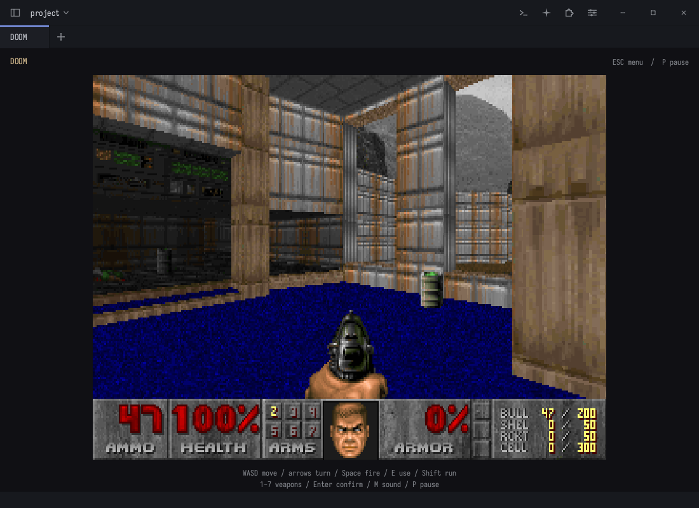

# DOOM in rhun

The original Doom engine in a rhun editor tab. Native C, original 320×200 pixels, keyboard
controls, sound effects and music. Builds for macOS Apple silicon, Linux x86-64 and Windows x64.



## Install in rhun

Use [rhun 0.18.2 or newer](https://github.com/vshvedov/rhun/releases/latest). Open
**Extensions → Install from GitHub…**, enter **rhun-editor/doom**, approve its audio access,
then run **DOOM: Play** from the command palette. Click the game to play. The extension downloads
its native binary, shareware episode and music instruments together. No compiler or extra
runtime is required.

To choose the first release explicitly, enter `rhun-editor/doom@0.1.0`. It has not been
submitted to the extension index, so the install dialog says it has not been reviewed there.

You can also download `doom-TARGET.tar.gz` from [Releases](https://github.com/rhun-editor/doom/releases)
and use **Extensions → Install → From an Archive**. Keep `sha256sums.txt` beside the archive
for verification. Every archive includes the binary, game data and licenses.

The extension needs macOS 12+ on Apple silicon, Linux x86-64 with glibc 2.35+ and PulseAudio
(or PipeWire's PulseAudio service) or ALSA, or 64-bit Windows 10+. Windows does not need MSYS2.
Older rhun versions use basic key pulses and lack the declared audio access needed for full play.

## Optional standalone preview

The first release also includes separate **rhun-doom-preview** downloads for trying the game
without changing an existing editor. They contain the original companion editor preview,
the installed extension and all assets. Extract the entire folder before launching it.

| System | Download | Start |
| --- | --- | --- |
| macOS Apple silicon | `rhun-doom-preview-macos-arm64.zip` | `Play DOOM.command` |
| Linux x86-64 | `rhun-doom-preview-linux-x86_64.tar.gz` | `sh "Play DOOM.sh"` |
| Windows x64 | `rhun-doom-preview-windows-x64.zip` | `Play DOOM.cmd` |

The first Mac standalone preview is not notarized. For a signed, notarized editor, use the
regular rhun release and install the extension above. Standalone settings and game state
stay inside the extracted folder.

## Controls

| Key | Action |
| --- | --- |
| W / S | Forward / backward |
| A / D | Strafe left / right |
| Left / Right | Turn |
| Space | Fire |
| E | Open doors / use |
| Shift | Run |
| 1 to 7 | Select weapon |
| Escape / Enter | Game menu / confirm |
| P | Pause or resume |
| M | Mute or unmute |

The game pauses when its tab loses focus or the editor becomes inactive. Held controls clear
on focus loss. Close and reopen the tab to continue. The command palette also has **DOOM: New
Game**, **DOOM: Pause or Resume**, and **DOOM: Toggle Sound**.

## Build locally

macOS needs the command line developer tools. Linux needs a C11 compiler and make.
Windows builds use MSYS2's MINGW64 environment with GCC and make. Dependencies are
vendored; no library downloads occur during compilation.

```sh
make -j4
DOOM_RHUN=/path/to/rhun sh tools/play-local.sh
```

The launcher builds the extension and creates a separate development install under `build/local`.
The ignored `.local-rhun` file can hold the editor path. The optional shareware fetch script
restores a missing WAD from Debian and verifies its checksum; clones already contain the WAD.

## Tests and automated releases

`.github/workflows/release.yml` builds on native macOS, Ubuntu and Windows runners. It verifies
and uses the official rhun 0.18.2 downloads, then tests both the new extension build and the
published DOOM 0.1.0 binary in that released editor. It runs PNG
unit tests, protocol conformance, real-editor gameplay tests, archive installation, picture-view
regressions and extracted-preview launcher tests. Linux and Windows also exercise their native
window key handlers. Preview extraction tests include spaces and non-ASCII paths. Windows runs
the extracted preview without MSYS2 or LLVM on PATH to catch missing runtime DLLs.

Linux CI uses a PulseAudio test sink. Hosted Mac and Windows runners use an explicitly selected
test audio device: they verify real-time effects and music synthesis, without claiming physical
speaker playback. Local Mac testing also uses Core Audio and checks denial without the audio
permission. Screenshots, logs and gameplay measurements are uploaded as workflow artifacts.

```sh
make test
python3 tools/package.py macos-arm64
DOOM_PACKAGE_ROOT="$PWD/build/package/macos-arm64/doom" python3 tools/check.py
DOOM_PACKAGE_ROOT="$PWD/build/package/macos-arm64/doom" DOOM_RHUN=/path/to/rhun python3 tests/run.py
```

A `vVERSION` tag equal to `extension.ini` builds and tests all three targets. Only after every
platform passes does the workflow publish a release with extension archives, standalone
preview downloads, SHA-256 checksums and complete corresponding source archives. Public releases
also receive GitHub build-provenance attestations for the extension archives.

## Game data and licenses

The repository and every binary download include the unchanged Doom 1.9 shareware IWAD. It
contains the first episode's graphics, maps, sounds and score. It remains copyrighted by id
Software under its [separate license and redistribution notice](data/SHAREWARE-LICENSE.txt).
Keep it unmodified and do not charge for it without id Software's permission. No registered Doom
or Doom II assets are included.

The portable music synthesizer uses the GPL-2.0 TimGM6mb General MIDI instrument bank, included
with its own notice. [data/README.md](data/README.md) records asset origins and checksums.

The extension needs no document, project, home, network or terminal access. Keyboard events come
from the focused picture view. Audio access is platform specific: Linux sound services can also
expose recording, and rhun currently has no Windows extension sandbox. This extension opens
playback streams only. It does not read global keyboard state or request Accessibility access.

## How it works

DoomGeneric supplies the engine. Indexed PNG frames travel through rhun's image/picture protocol.
The C SDK owns all protocol framing. Miniaudio supplies native playback and TinySoundFont renders
the original MUS score with the bundled instruments on all three platforms.

The engine and extension are GPL-2.0-or-later. Source for the exact release is provided in
`doom-source.tar.gz`; the bundled editor's source is in `rhun-preview-source.tar.gz`.
The vendored libraries have their own notices. See [LICENSE](LICENSE) and
[THIRD_PARTY.md](THIRD_PARTY.md).
